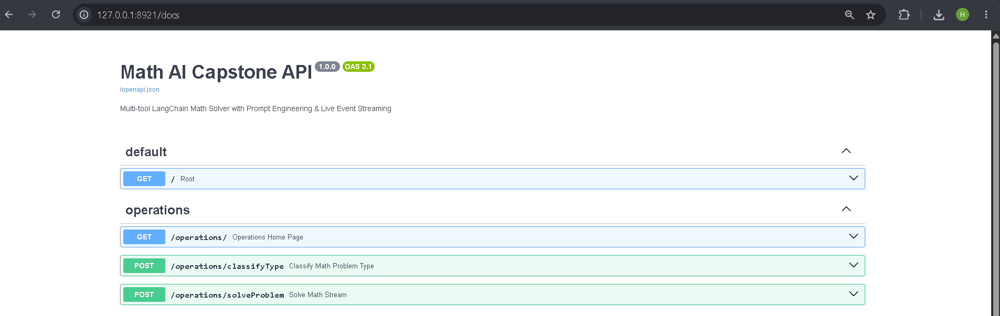
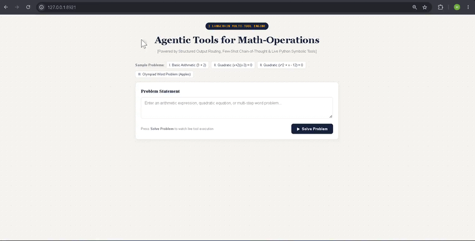
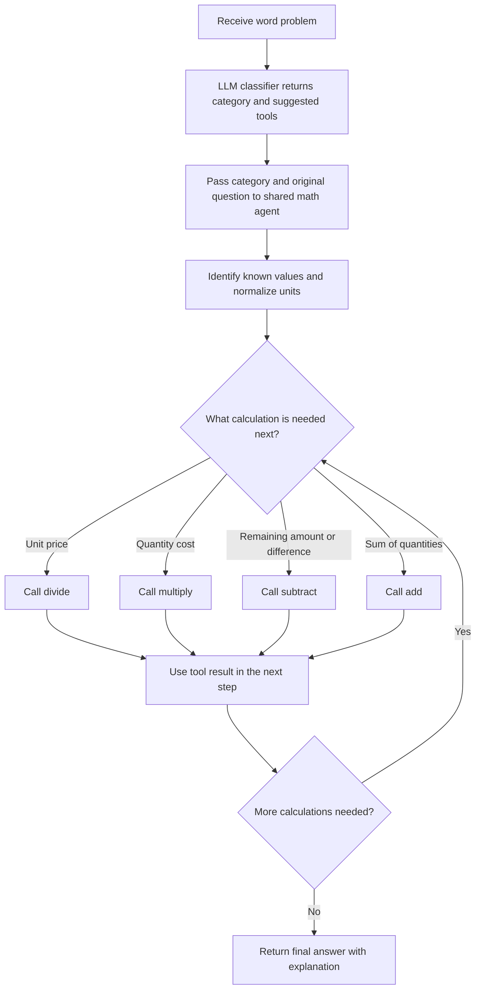

# PromptMathsTools

PromptMathsTools is a prompt-engineering capstone for solving math questions through a FastAPI service. It first classifies each problem (simple arithmetic, quadratic equation, or word problem), then supplies that classification and the original question to a LangChain agent equipped with arithmetic and algebra tools. The agent uses role instructions, chain-of-thought task guidance, and few-shot examples to select and call tools as needed.

# Project API's used:
<div>
  
</div>

# Project Video Animation: 
<div>
  
</div>

## Architecture

```text
config/
  config.json                    LLM provider and model settings
frontend/
  index.html                     Basic page served at /
  index.css                      Frontend styles
  index.js                       Frontend JavaScript
src/promptmathstools/
  main.py                        FastAPI app and static frontend routes
  agents/
    math_solver_agent.py         Builds the LangChain math agent
  apiRouter/
    operations.py                Math classification and solving endpoints
  prompts/                       Classifier, role, few-shot, and reasoning prompts
  tools/                         Arithmetic and algebra tools
  utility/
    common.py                    Asynchronous problem classification
    loadConfig.py                Loads config/config.json and .env
    loadllm.py                   Creates the configured chat model
  tests/
    test_classifier.py           Classifier category tests (uses configured LLM)
    test_math_tools.py            Arithmetic, algebra, and tool-chain tests
pyproject.toml                   Project metadata and dependencies
uv.lock                          Locked dependency versions
.python-version                 Python version selected by uv (3.12)
```

## Request and agent flow

```text
Browser / API client
       |
       | POST /operations/classifyType  (JSON response)
       |              or
       | POST /operations/solveProblem (SSE response)
       v
FastAPI app (src/promptmathstools/main.py)
       |
       v
Operations router validates {"question": "..."}
       |
       v
Structured problem classifier
  - loads configured chat model
  - classifies as simple_arithmetic, quadratic_equation, or word_problem
  - returns category and suggested tool names
       |
       | category + original question
       v
LangChain math agent (built once when the operations module loads)
  - configured chat model
  - role/system instructions + chain-of-thought task guidance
  - few-shot examples
  - arithmetic and algebra tool set
       |
       | agent selects and invokes tools as needed
       v
Math tools: add, subtract, multiply, divide, solve_quadratic
       |
       v
Final answer
  - classifyType: category, planned tools, and answer as JSON
  - solveProblem: classifier/tool progress and final answer as SSE events
```

The classifier does not select a separate specialist agent: it labels the problem and provides suggested tool names, then the same math agent receives the category and question and decides how to solve it using its available tools. Prompt techniques used in this process include structured output for classification, role prompting, chain-of-thought task instructions, and few-shot examples.

The `/operations/solveProblem` SSE endpoint emits classifier progress, agent activity, tool start/end events, and answer or error events. The frontend's `index.js` submits questions to this endpoint and updates the page as events arrive; the API can also be called directly by other streaming clients.

## How classification guides tool use

The classifier asks the configured language model to return a structured result with two fields: a problem `category` and `suggested_tools`. The category is one of:

| Category | Typical problem | Tools the classifier may suggest |
| --- | --- | --- |
| `simple_arithmetic` | A direct calculation such as “What is 12 multiplied by 8?” | `add`, `subtract`, `multiply`, or `divide` |
| `quadratic_equation` | Finding the roots of a quadratic, such as `(x + 2)(x - 3) = 0` | `solve_quadratic` |
| `word_problem` | A story problem that must be translated into one or more calculations | A sequence of arithmetic tools based on the quantities and operations involved |

These are labels and recommendations, not fixed execution plans. The same math agent receives the category together with the original question. It can select and call one or more tools from the full tool set (`add`, `subtract`, `multiply`, `divide`, and `solve_quadratic`), using each result to inform the next step. For word problems, the agent is instructed to identify known values, convert units where needed, determine the operation at each step, and wait for each tool result before continuing. Unit conversion is described in the prompt but is not a separate registered tool.

For example, consider: “2 kg of mangoes cost 200 rupees. I bought 500 g and paid with 500 rupees. How much change should I get?” The classifier can identify this as a `word_problem` and suggest `divide`, `multiply`, and `subtract`. The agent then works through the quantities in sequence:

1. Normalize the quantity: 500 g = 0.5 kg.
2. Find the unit price: `divide(200, 2)` → 100 rupees per kg.
3. Find the cost: `multiply(100, 0.5)` → 50 rupees.
4. Find the change: `subtract(500, 50)` → 450 rupees.



The actual calls depend on the question; this chart illustrates a common multi-step path rather than a hard-coded word-problem pipeline. With `/operations/solveProblem`, API clients can observe the classifier result, each tool call and its arguments, each tool result and duration, and the final answer as server-sent events.

## Prerequisites

- Windows, macOS, or Linux
- Python 3.12 or later
- [uv](https://docs.astral.sh/uv/)
- An LLM provider configured for the application. By default this is Ollama with `qwen2.5-coder:3b`.

## Set up

From the repository root, install/select Python and create the project environment with the locked dependencies:

```powershell
uv python install 3.12
uv sync
uv run python --version
```

For the default Ollama provider, install Ollama, ensure its service is running, and download the configured model:

```powershell
ollama pull qwen2.5-coder:3b
```

The provider and model settings are in `config/config.json`. To use Gemini instead, set `"provider"` to `"gemini"` there and provide a `GOOGLE_API_KEY` environment variable (for example, in a local `.env` file at the repository root). Do not commit API keys or `.env` files.

## Run the API

Start the application from the repository root so its relative `config/` and `frontend/` paths resolve:

```powershell
uv run python -m uvicorn src.promptmathstools.main:app --port 8921  --reload
```

Then open:

- App page: <http://127.0.0.1:8921/>
- Interactive API documentation: <http://127.0.0.1:8921/docs>
- Operations health-style route: <http://127.0.0.1:8921/operations/>

### API endpoints

`POST /operations/classifyType` returns the category, suggested tools, and answer as JSON:

```powershell
curl.exe -X POST http://127.0.0.1:8921/operations/classifyType `
  -H "Content-Type: application/json" `
  -d "{\"question\":\"What is 12 multiplied by 8?\"}"
```

`POST /operations/solveProblem` streams progress and the final answer as SSE:

```powershell
curl.exe -N -X POST http://127.0.0.1:8921/operations/solveProblem `
  -H "Content-Type: application/json" `
  -d "{\"question\":\"What is 12 multiplied by 8?\"}"
```

Both endpoints accept a JSON object with a non-empty `question` string.

### Event streaming: backend and browser client

Server-sent events (SSE) let the server send progress to a client as the work happens instead of waiting to return one final JSON response. `POST /operations/solveProblem` accepts the same JSON request as `/classifyType`, but responds as `text/event-stream`. Each event is a `data:` line containing a JSON object and is separated from the next event by a blank line:

```text
data: {"stage":"classifier","status":"running","message":"Analyzing problem structure & routing..."}

data: {"stage":"classifier","status":"done","category":"word_problem","planned_tools":["divide","multiply","subtract"],"duration_ms":42}
```

#### What the streaming endpoint does in `operations.py`

- `MathRequest` validates the request body and requires a non-empty `question`.
- `solve_math_stream(req)` handles `POST /operations/solveProblem` and returns a `StreamingResponse` with media type `text/event-stream`. It defines and streams the nested `event_generator()` rather than collecting the whole response before sending it.
- `event_generator()` emits a classifier-running event, awaits `classify_problem_async`, and emits the classification, suggested tools, and classifier duration. It then passes the category and original question to the shared math agent through `astream_events(..., version="v2")`.
- While reading the agent events, it maps `on_chat_model_start` to an `llm` progress event, `on_tool_start` to a `tool` running event with the tool name, arguments, and run ID, and `on_tool_end` to a `tool` done event with the output and elapsed milliseconds. Run IDs associate a tool's start and completion.
- On `on_chat_model_end`, it keeps non-tool-call text as the final answer. The completion payload uses that text if available, otherwise the most recent tool output, and finally `"No answer generated."`. Exceptions are printed to the server log and sent to the client as an `error` event.

The event payloads are designed for incremental display:

| `stage` | `status` | Important fields | Meaning |
| --- | --- | --- | --- |
| `classifier` | `running` | `message` | Classification has started. |
| `classifier` | `done` | `category`, `planned_tools`, `duration_ms` | Classification is ready; agent solving follows. |
| `llm` | `running` | `message` | The agent is processing and selecting an action. |
| `tool` | `running` | `run_id`, `tool`, `args` | A tool call has started. |
| `tool` | `done` | `run_id`, `tool`, `args`, `output`, `duration_ms` | A tool call returned its result. |
| `complete` | — | `answer` | An answer payload is available. |
| `error` | — | `message` | The stream encountered an error. |

**Current implementation note:** the `complete` event is yielded inside the loop over agent events. It may therefore be sent multiple times or before the agent event stream has finished; clients should not assume it is a single terminal event until the yield is moved after that loop.

#### How the browser uses the stream in `index.js`

The page uses `fetch()` because it sends a `POST` request with a JSON body; the browser's native `EventSource` API only supports a URL-based `GET` connection. The submit handler in `index.js` prevents the form's normal page reload, disables the submit button, clears the previous result, and posts `{ "question": "..." }` to `/operations/solveProblem`.

The response body is read as a stream with `response.body.getReader()`. A `TextDecoder` converts incoming bytes to text, while a buffer retains any partial event until the next network chunk arrives. Complete events are separated on the SSE blank line, their `data:` prefix is removed, and the JSON payload is parsed. The client then updates the classifier category and planned-tool row, shows agent activity, adds or updates tool rows with inputs/results/timings, and displays the answer or error. `addStep(id, htmlContent, isCompleted)` creates a pipeline row or updates the existing row with the same ID; the sample problem chips simply fill the question input.

This makes the live pipeline visible in the page while solving is in progress. For command-line streaming usage, see the `curl.exe -N` example above; `-N` disables curl's output buffering so incoming events appear promptly.

## Tests

Run the test suite with:

```powershell
uv run pytest
```

The classifier tests also call the configured LLM and therefore need the provider (and its model/API credentials) available. At present, test collection is blocked because `src/promptmathstools/tests/test_math_tools.py` imports math tools from `apiRouter.operations`; the tools are defined in `promptmathstools.tools`. The classifier test at `src/promptmathstools/tests/test_classifier.py` also needs the configured model service and credentials. Fix the test import and configure the model before expecting the full suite to pass.

## Development

- Add or update model and provider settings in `config/config.json`.
- Keep prompt definitions in `src/promptmathstools/prompts/` and tool implementations in `src/promptmathstools/tools/`.
- Add API routes and request/response schemas in `src/promptmathstools/apiRouter/operations.py`.
- After changing dependencies in `pyproject.toml`, regenerate/update the lockfile with `uv lock`, then install with `uv sync`.
